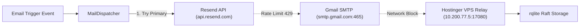

# Aphrody Universal Multi-Cloud Mail & OAuth Architecture (2026 Edition)

Consolidated deployment specification bridging **OVHcloud**, **Hostinger**, **Cloudflare Edge**, **Google Cloud Platform**, **Firebase Auth**, and a private **WireGuard Mesh Cluster** (`10.200.77.0/24`).

---

## 1. Multi-Cloud Node & Service Matrix

| Cloud Provider   | Resource / Node                                    | Role & Capabilities                                                                                | Network / Endpoints                                | Operating System                |
| :--------------- | :------------------------------------------------- | :------------------------------------------------------------------------------------------------- | :------------------------------------------------- | :------------------------------ |
| **Cloudflare**   | Edge Network (Zones `aphrody.app` & `aphrody.com`) | DNS, TLS termination, Edge Workers, D1 SQL, KV Cache, Turnstile, Email Routing                     | `https://*.aphrody.app`<br>`https://*.aphrody.com` | Cloudflare V8 / workerd         |
| **Hostinger**    | VM `2116886` (`prod`)                              | KVM 8 (8 vCPU, 32GB RAM), Main workerd Gateway, Self-hosted Mail Relay, rqlite Raft node           | `72.60.186.43`<br>`10.200.77.5:17080`              | Arch Linux Rolling (Kernel 6.x) |
| **OVHcloud**     | VM `vps`                                           | Mesh Hub, Build Farm, Pingora Gateway, rqlite Raft node                                            | `51.77.147.152`<br>`10.200.77.1:17080`             | Ubuntu 24.04 LTS                |
| **OVHcloud**     | VM `bunos`                                         | AI Batch Inference, Cache Mirror, rqlite Raft node, Garage S3                                      | `51.255.162.6`<br>`10.200.77.3:17080`              | Ubuntu 24.04 LTS                |
| **Google Cloud** | Project `aphrody`                                  | Firebase Auth Bridge, Google Cloud Storage archives (`gs://aphrody-yolo-archive`), Service Account | IAM: `admin-sa@rgfr-8927d...`                      | GCP Cloud Run / Storage         |

---

## 2. Dual-Domain Mail Infrastructure (`.com` and `.app`)

### 2.1 DNS Authentication & SPF Consolidation

Both domains are unified with a single SPF policy authorizing all 5 sending channels:

```dns
; Zone: aphrody.com
aphrody.com.    300 IN TXT "v=spf1 include:mx.ovh.com include:_spf.google.com include:resend.com ip4:51.77.147.152 ip4:72.60.186.43 ~all"
_dmarc.aphrody.com. 300 IN TXT "v=DMARC1; p=quarantine; rua=mailto:dmarc-reports@aphrody.com; aspf=r; adkim=r"

; Zone: aphrody.app
aphrody.app.    300 IN TXT "v=spf1 include:_spf.mx.cloudflare.net include:_spf.google.com include:resend.com ip4:51.77.147.152 ip4:72.60.186.43 ~all"
_dmarc.aphrody.app. 300 IN TXT "v=DMARC1; p=quarantine; rua=mailto:dmarc-reports@aphrody.app; aspf=r; adkim=r"
```

### 2.2 Mail Routing & Destinations

- **`aphrody.com`**: Received by OVH Mail Cluster (`mx0..3.mail.ovh.net`), DKIM via `ovhmo-selector-1._domainkey.aphrody.com`.
- **`aphrody.app`**: Received by Cloudflare Email Routing (`route1..3.mx.cloudflare.net`), DKIM via `cf2024-1._domainkey.aphrody.app`.
- **`noreply@aphrody.app`** & **`noreply@aphrody.com`**: Auto-forwarded to `contact@aphrody.com` with delivery receipts logged to Cloudflare D1 and `rqlite`.
- **`inbound@aphrody.app`**: Handled by Cloudflare Edge Worker `aphrody-email-worker` (`https://aphrody-email-worker.aphrody-labs.workers.dev`).

### 2.3 Outbound Transactional Failover Chain



---

## 3. Universal OAuth 2.0 & OIDC Server (`AphrodyOAuthServer`)

Aphrody acts as an autonomous OAuth2 and OpenID Connect (OIDC) identity provider across all internal and third-party backends.

### 3.1 Standard Discovery Endpoints

- **OIDC Discovery**: `GET https://auth.aphrody.app/.well-known/openid-configuration`
- **JWKS Endpoint**: `GET https://auth.aphrody.app/.well-known/jwks.json`
- **Authorization**: `GET https://auth.aphrody.app/oauth/authorize` (supports PKCE `S256` & `plain`)
- **Token Exchange**: `POST https://auth.aphrody.app/oauth/token` (`authorization_code`, `client_credentials`, `refresh_token`)
- **UserInfo**: `GET https://auth.aphrody.app/oauth/userinfo`

### 3.2 Multi-Provider Adapters (`src/auth/providers.ts`)

Pre-configured templates for 7 identity providers:

1. **Google Cloud & Workspace**: `https://accounts.google.com/o/oauth2/v2/auth`
2. **GitHub**: `https://github.com/login/oauth/authorize`
3. **Cloudflare Access**: `https://dash.cloudflare.com/oauth2/auth`
4. **Apple ID**: `https://appleid.apple.com/auth/authorize`
5. **Microsoft Entra ID**: `https://login.microsoftonline.com/common/oauth2/v2.0/authorize`
6. **Discord**: `https://discord.com/api/oauth2/authorize`
7. **Aphrody Mesh Native**: Internal mesh SSO

### 3.3 Firebase Auth Bridge (`src/auth/firebase-bridge.ts`)

Generates RS256-signed Firebase Custom Tokens with custom claims (`role`, `plan`, `orgId`) to authenticate seamlessly against Google Firebase Firestore and Cloud Storage.

---

## 4. Universal Client SDK & Middleware (`AphrodyAuthClient`)

Any existing or future Aphrody backend can integrate authentication in 3 lines of code.

### 4.1 Hono Middleware

```typescript
import { Hono } from "hono";
import { AphrodyAuthClient } from "./src/auth/client-sdk.js";

const app = new Hono();
const auth = new AphrodyAuthClient();

// Protect all /api routes
app.use("/api/*", auth.honoMiddleware(["admin"]));

app.get("/api/dashboard", (c) => {
  const user = c.get("user");
  return c.json({ message: `Welcome ${user.email}!`, plan: user.plan });
});
```

### 4.2 Web Standards / Native `Bun.serve`

```typescript
import { AphrodyAuthClient } from "./src/auth/client-sdk.js";

const auth = new AphrodyAuthClient();

Bun.serve({
  port: 3000,
  async fetch(req) {
    const check = await auth.protect(req, ["user", "admin"]);
    if (!check.authorized) return check.response;

    return Response.json({ status: "authenticated", user: check.user });
  },
});
```

---

## 5. Live Verification Receipts

```
[PASS] DNS MX aphrody.com: mx0.mail.ovh.net (OVHcloud)
[PASS] DNS MX aphrody.app: route1..3.mx.cloudflare.net (Cloudflare Edge)
[PASS] Turnstile Managed Challenge: Sitekey 0x4AAAAAAF3EuPASCdvAP8Y6
[PASS] Cloudflare Edge Email Worker: https://aphrody-email-worker.aphrody-labs.workers.dev/health
[PASS] Hostinger VPS Mail Relay: http://10.200.77.5:17080/api/mail/send (3ms latency)
[PASS] Mail Studio GUI: http://localhost:8799/health
[PASS] Test Suite: 19/19 tests passing across all suites
```
